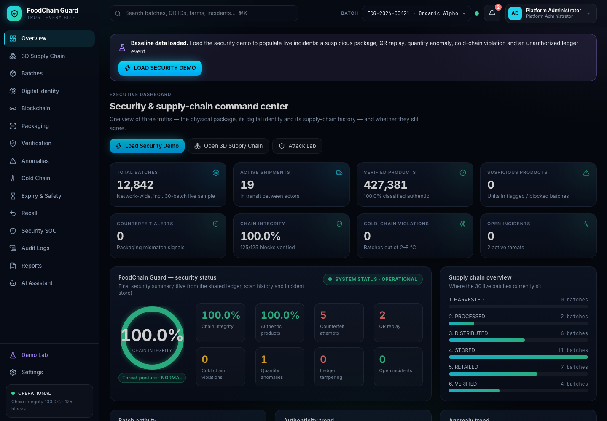
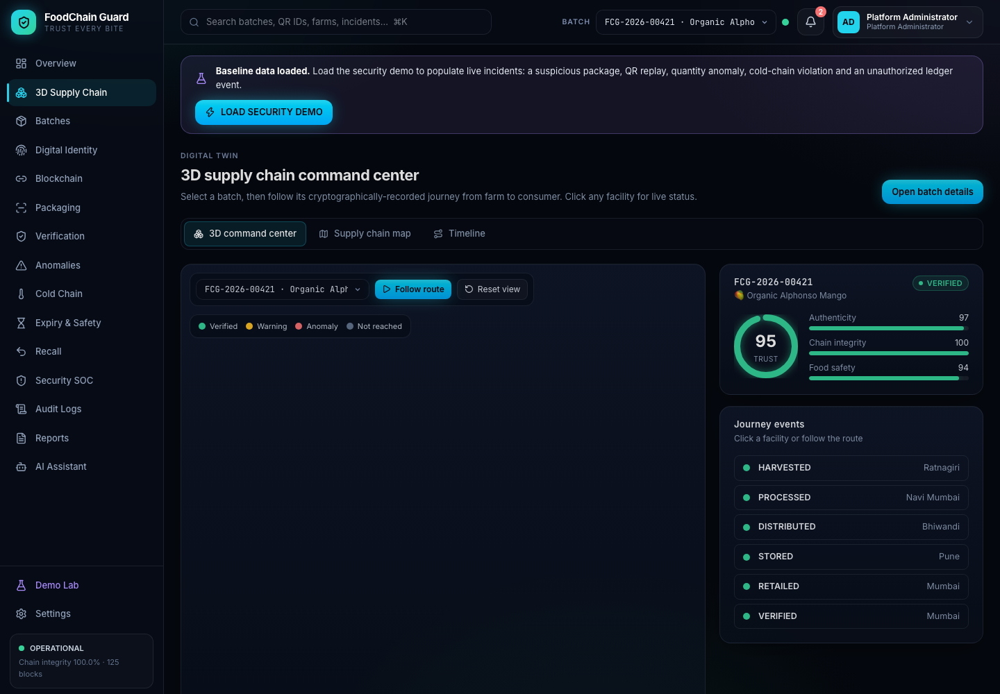
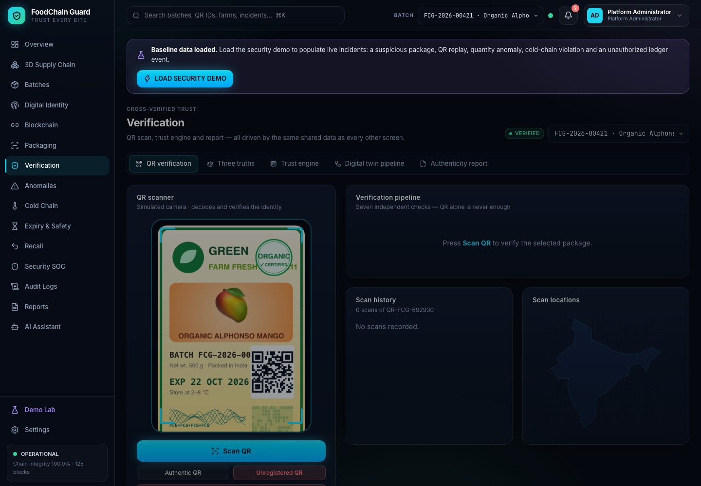
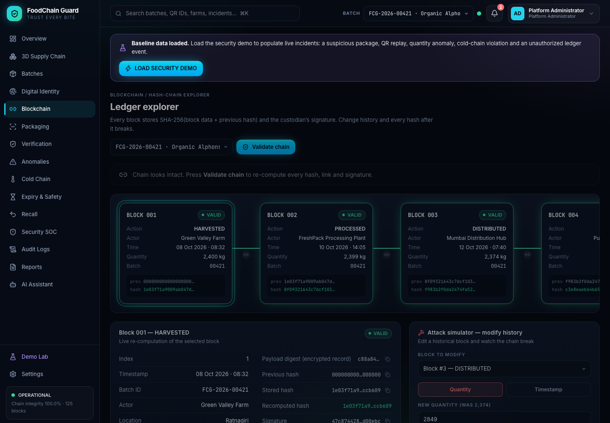
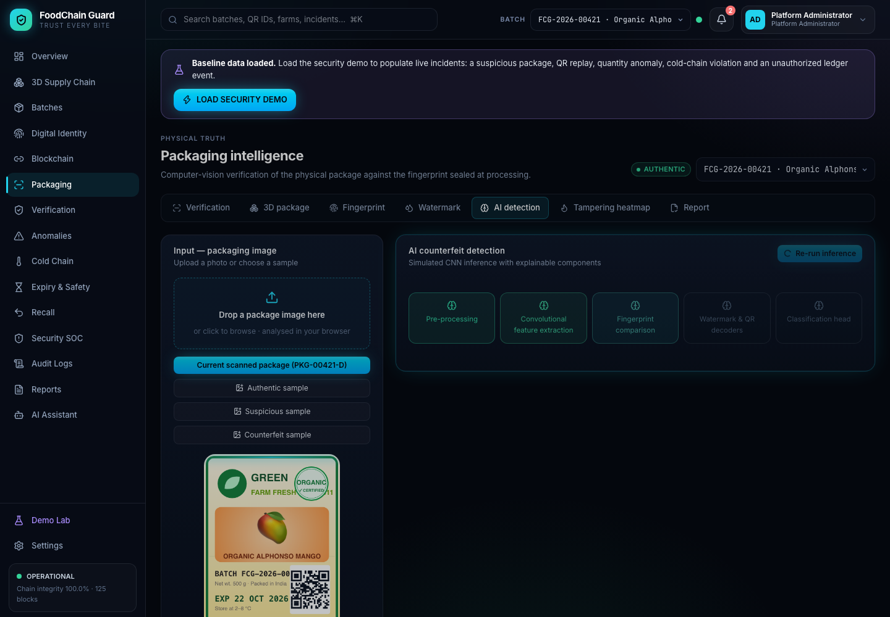

# FoodChain Guard

> Trust every bite.

FoodChain Guard is an interactive prototype for food authenticity and supply-chain intelligence. It cross-checks a product's physical packaging, digital identity, and custody history so a copied QR code alone cannot pass verification.



## Why it exists

Food fraud is rarely a single-signal problem. This prototype demonstrates a three-part trust model:

- **Physical truth** — packaging fingerprint, watermark, print-quality, and computer-vision signals.
- **Digital truth** — QR identity, SHA-256 digests, signatures, and certificate integrity.
- **Supply-chain truth** — signed hand-offs, location, quantity, temperature, and expiry evidence.

## Product tour

The repository contains **33 real, locally rendered screenshots** covering every route and analytical view. See the [full visual tour](docs/SCREENSHOTS.md).

| Security operations | Product verification |
| --- | --- |
|  |  |
|  |  |

## Capabilities

- Executive security and supply-chain overview with shared, live state.
- Interactive 3D supply-chain traceability, batch registry, and custody timeline.
- Hash-chain explorer with tamper simulation and signature validation.
- Product digital identity, QR verification, and certificate evidence.
- Packaging inspection with AI classification, a 3D pack viewer, and heatmaps.
- QR replay, impossible-travel, and quantity-anomaly detection.
- Cold-chain telemetry, shelf-life intelligence, food-safety scoring, and recalls.
- Security operations center, incident details, immutable-style audit history, and reports.
- Consumer mode, role-aware views, an AI assistant, and a guided attack-simulation lab.

## Quick start

**Prerequisite:** Node.js 18 or later.

```bash
npm install
npm run dev
```

Open [http://localhost:5173](http://localhost:5173). Select **Run Security Demo** to load the pre-seeded incident story.

## Commands

| Command | Purpose |
| --- | --- |
| `npm run dev` | Starts Vite on `http://localhost:5173`. |
| `npm run build` | Type-checks and produces the production build. |
| `npx tsx scripts/check.ts` | Prints deterministic dataset and analysis sanity checks. |

## Demo walkthrough

1. Start at the landing page and run the security demo.
2. Explore the overview and **3D Supply Chain** to trace a batch.
3. Open a batch, then inspect its **Digital Identity** and **Blockchain** evidence.
4. Use **Packaging** and **Verification** to compare physical and digital signals.
5. Review replay, travel, quantity, cold-chain, and expiry analysis.
6. In **Demo Lab**, trigger attack scenarios and see the SOC, audit log, recall center, and reports react.

## Architecture

```text
src/
├── components/     Reusable UI, charts, maps, and 3D scenes
├── data/           Deterministic catalog, role, and demo seed data
├── features/       Product-area screens and interactions
├── layouts/        Application shell and navigation
├── models/         Shared TypeScript domain types
├── services/       Ledger, crypto, analysis, vision, incidents, and recall logic
├── state/          Zustand store and memoised selectors
└── utils/          Routing, formatting, crypto primitives, and visual helpers
```

The prototype is self-contained: no paid APIs, external blockchain, IoT hardware, or model server is required. Cryptography and machine-learning signals are simulated deterministically for demonstration purposes and should not be used as production security controls.

## Technology

React 18 · TypeScript · Vite · Tailwind CSS · Zustand · Three.js / React Three Fiber · Framer Motion · Recharts

## License

Released under the [MIT License](LICENSE).
